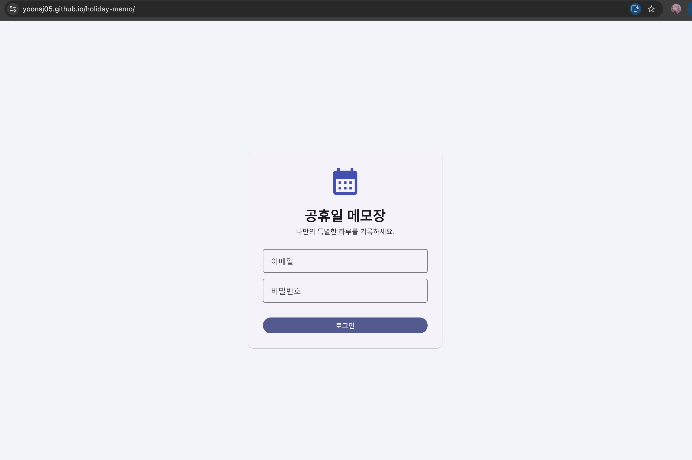
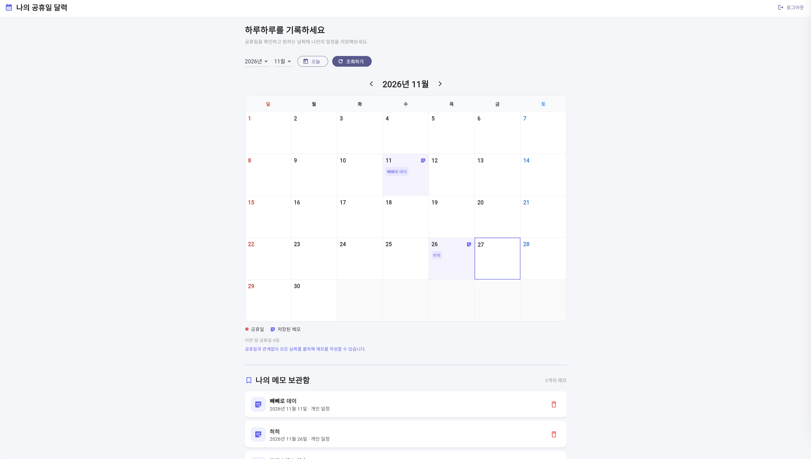

# 한국 공휴일 달력 & 나만의 한 줄 메모장

## 1. 프로젝트 소개
한국의 공휴일 정보를 실시간으로 조회하고, 공휴일별 개인 일정과 한 줄 메모를 저장할 수 있는 Flutter 웹앱입니다.

## 2. 배포 링크
https://yoonsj05.github.io/holiday-memo/

## 3. 사용 기술
- Flutter Web
- Firebase Authentication
- Cloud Firestore
- Open API (JSON)
- GitHub Pages

## 4. 사용 API
- 제공 기관: 한국천문연구원
- API 명칭: 한국천문연구원_특일 정보
- 제공처: 공공데이터포털(data.go.kr)
- 데이터 형식: JSON

## 5. 주요 기능
- 이메일 및 비밀번호 로그인·로그아웃
- 로그인 실패 시 오류 메시지 표시
- 연도 및 월별 실시간 공휴일 조회
- 공휴일별 개인 메모 저장·조회·삭제
- 사용자 UID 기반 개인 데이터 관리
- 새로고침 후에도 저장된 메모 유지

## 6. 테스트 계정
- ID: test@example.com
- PW: test1234

## 7. 실행 화면

### 로그인 화면

### 공휴일 조회 및 메모 저장 화면

